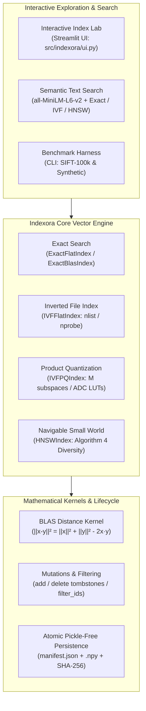

# Indexora

[](https://www.python.org/downloads/)
[]()
[](https://opensource.org/licenses/MIT)

**A learning-first vector search engine built from scratch in Python and NumPy.**

Explore the mathematical foundations, systems trade-offs, and algorithms behind modern vector search engines—from high-performance BLAS distance kernels to Inverted Files (IVF), Product Quantization (PQ), and Hierarchical Navigable Small Worlds (HNSW).

---

## 30-Second Elevator Pitch

Modern vector databases (e.g., Pinecone, Milvus, Qdrant) power generative AI, retrieval-augmented generation (RAG), and similarity search. Yet their internal mechanics—Voronoi partitioning, Asymmetric Distance Computation, proximity graph routing, and SIMD hardware acceleration—remain opaque black boxes to most engineers.

**Indexora demystifies vector search from first principles.** Built with pure Python and NumPy (zero C++ dependencies for core algorithms), Indexora demonstrates how vector indexes work under the hood:
1. **Math to Code:** Implements squared Euclidean distance kernels, $K$-means++, inverted posting lists, subspace residual quantization, and multi-layer HNSW graphs.
2. **Systems-Level Rigor:** Contrasts coordinate-difference reference loops with BLAS Level-3 GEMM matrix multiplication ($\|x-y\|^2 = \|x\|^2 + \|y\|^2 - 2x \cdot y$), delivering $3.15\times$ speedups.
3. **Full Lifecycle:** Supports incremental mutations (`add`), tombstones (`delete`), single-stage ID/category filtering (`filter_ids`), and pickle-free atomic persistence (`save_index`/`load_index`) with streaming SHA-256 manifests.
4. **End-to-End Applications:** Features an interactive web lab (`streamlit run src/indexora/ui.py`) and live semantic text search using neural sentence embeddings.

---

## System Architecture



---

## Algorithm Selection Guide

| Algorithm | Index Class | Build Cost | Query Latency | Memory Footprint | Recall Guarantee | When to Use |
| :--- | :--- | :---: | :---: | :---: | :---: | :--- |
| **Exact (Ref)** | `ExactFlatIndex` | None ($O(1)$) | High ($O(N \cdot d)$) | Baseline ($4 \cdot N \cdot d$ B) | 100% | Correctness oracle & numerical validation. |
| **Exact (BLAS)** | `ExactBlasIndex` | Fast ($O(1)$) | Low for $N \le 10^4$ | Baseline ($4 \cdot N \cdot d$ B) | 100% | Datasets up to 10k vectors or when 100% recall is strictly required. |
| **IVF-Flat** | `IVFFlatIndex` | Moderate ($K$-means) | Sub-linear ($O(\frac{N}{\text{nlist}} \cdot \text{nprobe})$) | Baseline ($+ \text{centroids}$) | High (tunable via `nprobe`) | Low-memory approximate search with fast build times on clustered data. |
| **IVF-PQ** | `IVFPQIndex` | High (residual $K$-means) | Sub-linear ($O(\text{cand} \cdot M)$ table lookups) | **Very Low (15x–64x compression)** | Moderate to High | Memory-constrained environments; massive datasets that must fit in RAM. |
| **HNSW** | `HNSWIndex` | High ($O(N \log N)$ graph construction) | **Ultra-low ($O(\log N)$)** | Moderate ($+ M$ edges/node) | **Very High (98%–100%)** | Low-latency applications (RAG, live search) prioritizing top-k retrieval speed. |

---

## 10-Second Quickstart

```python
import numpy as np
from indexora import HNSWIndex, normalize_l2

# 1. Prepare unit-normalized vectors (d=128)
vectors = normalize_l2(np.random.randn(1000, 128).astype(np.float32))
ids = np.arange(1000, dtype=np.int64)

# 2. Build an HNSW proximity graph
index = HNSWIndex(database=vectors, ids=ids, M=8, ef_construction=32, ef_search=16)

# 3. Query the nearest neighbors with cosine ranking
query = normalize_l2(np.random.randn(128).astype(np.float32))
result = index.search(query, k=5)

# 4. Results contain IDs, squared L2 distances, and valid match mask
print("Retrieved IDs:", result.ids)
print("Squared L2 Distances:", result.distances)
print("Cosine Similarities:", 1.0 - 0.5 * result.distances)
```

---

## Purpose

Indexora explores the internals of vector indexing and approximate nearest-neighbor (ANN) search from first principles. It begins with a trustworthy exact-search baseline and reproducible evaluation, progressively adding algorithms such as k-means, IVF-Flat, Product Quantization (PQ), IVF-PQ, and HNSW to benchmark recall, latency, memory footprint, and build cost.

The core educational philosophy is **learning ownership**: the core algorithm bodies are implemented and understood directly by the human owner, while supporting engineering (packaging, benchmarks, adapters, test harnesses) is agent-assisted.

## Current Status

- **Phase 0 (Setup):** Complete. Minimal package layout, dependency configuration, smoke tests, conventions, and CI workflow established.
- **Phase 1 (Distance Kernels & Top-k):** Complete. Reference squared-L2 kernel with float64 accumulation, deterministic tie-breaking, and frozen `SearchResult` container.
- **Phase 2 (Exact Flat & Ground Truth):** Complete. Exhaustive exact search baseline (`exact_search`, `ExactFlatIndex`) and ground-truth generation (`generate_ground_truth`).
- **Phase 3 (Data & Dataset Utilities):** Complete. `VectorDataset` split abstraction, stable IDs, reproducible synthetic & clustered generators, L2 normalization with zero-vector policy, and checksummed offline cache.
- **Phase 4 (Clustering):** Complete. $K$-means++ centroid initialization, vectorized Lloyd iteration loop, configurable empty-cluster policies (`reseed_furthest`, `keep`, `error`), and frozen `KMeansResult` container.
- **Phase 5 (IVF-Flat):** Complete. Inverted File Flat index with coarse k-means quantization, durable int64 IDs, immutable posting lists, multi-probe candidate gathering, and bit-for-bit all-probe equivalence with exact search.
- **Phase 6 (Benchmark Harness v0.1):** Complete. Ground-truth baseline evaluation, multi-probe IVF sweeps across nlist/nprobe, Recall@k with sentinel exclusion, distance computation accounting, machine-readable JSON/CSV reporting, automated plot generation, and CLI runner.
- **Phase 6.5 (Benchmark Hardening & Real Data):** Complete. Disentangled ID `-1` from array padding via explicit `SearchResult.mask`, separated individual per-query latency percentiles from full-batch throughput (QPS), added persistent index storage memory metrics (`index_memory_bytes`, `index_memory_mib`, `bytes_per_vector`), instrumented actual search work directly in search paths, added binary `.fvecs` SIFT1M subset loader (`read_fvecs`, `load_sift_dataset`) with streaming SHA-256 verification, and expanded CI with an offline smoke-benchmark gate.
- **Phase 6.6 (Performance Baseline & Benchmark Credibility):** Complete. Added fast BLAS-accelerated exact search (`ExactBlasIndex`, `exact_search_blas`, `pairwise_squared_l2_blas`) leveraging $\|x-y\|^2 = \|x\|^2 + \|y\|^2 - 2(x \cdot y)$ while preserving the coordinate-difference reference kernel as the correctness oracle; accelerated K-means centroid assignment; bounded query batch memory via `max_query_chunk=1024`; added distance-aware Recall@k (`compute_distance_aware_recall_at_k`) to resolve boundary equidistant ties; exposed K-means convergence diagnostics (`kmeans_n_iter`, `kmeans_converged`, `kmeans_inertia`); tracked peak process RSS memory; and updated benchmark manifests, CSVs, and dual-baseline plots.
- **Phase 7 (Reference Adapters):** Complete. Added optional adapters (`FaissFlatIndex`, `FaissIVFFlatIndex`, `HnswlibIndex`) with normalized `SearchResult` containers, squared L2 distance contracts, arbitrary `int64` ID mapping (including negative IDs), memory accounting, and optional dependency isolation.
- **Phase 8 (Profiling & Acceleration):** Complete. Targeted profiling identified distance calculation as the primary IVF-Flat bottleneck (83.0% of search time). Accelerated search via batched coarse quantization, BLAS candidate distance scoring, and zero-copy candidate handling, delivering a **1.56x to 2.62x latency speedup** and up to **2.62x higher throughput** while preserving exact ID tie-breaking and reference oracle mode.
- **Phase 9 (Product Quantization & IVF-PQ):** Complete. Added `ProductQuantizer` and `IVFPQIndex` with subspace decomposition ($d = M \times d_{\text{sub}}$), compact quantization codes (`uint8`/`uint16`), coarse-centroid residual encoding, and Asymmetric Distance Computation (ADC) lookup table candidate scoring. Demonstrated **64x raw vector compression** ($512 \to 8$ bytes/vector for $M=8, k_{\text{sub}}=256$) and **15.2x total persistent index memory compression** (reducing index footprint from 5.01 MB to 0.33 MB for $N=10,000, d=128$, accounting for stored `int64` IDs and codebooks) while maintaining full compatibility with Indexora's ID and search result contracts.
- **Phase 10 (Custom HNSW Index):** Complete. Built Hierarchical Navigable Small World (`HNSWIndex`, `hnsw_build`, `hnsw_search`) from scratch in Python and NumPy without external libraries. Features multi-layer proximity graphs with exponential level sampling ($m_L = 1 / \ln(M)$), bounded best-first greedy beam search, Malkov & Yashunin's Algorithm 4 heuristic diversity neighbor selection, exact graph invariant checks, arbitrary `int64` IDs (including negative IDs), exact memory accounting, and benchmark integration achieving **1.0000 Recall@10** on synthetic clustered data while evaluating only ~15% of database distances.
- **Phase 11 (Mutations, Filtering & Persistence):** Complete. Implemented incremental additions (`add`), deletions (`delete`), filtered candidate search (`filter_ids`), and atomic disk persistence (`save_index`, `load_index`) across all core index implementations. Features pickle-free `.npy` storage, SHA-256 manifest integrity verification, CSR graph serialization for HNSW without re-indexing, and codebook preservation for IVF-PQ without retraining.
- **Phase 12A (Interactive Index Lab):** Complete. Built a local-first interactive web laboratory in Streamlit backed directly by Indexora's actual vector engines. Features interactive query search with 2D PCA spatial maps, comparative accuracy-vs-latency benchmarks across all 5 core indexes, real-time incremental additions and tombstone deletions, and atomic disk persistence verification with SHA-256 checksums.
- **Phase 12B (Semantic Text Search Integration):** Complete. Delivered end-to-end natural language semantic search backed directly by Indexora's native vector retrieval engines (Exact BLAS, IVF-Flat, and HNSW) and pretrained sentence embeddings (`sentence-transformers/all-MiniLM-L6-v2`). Features a curated 25-document technical demonstration corpus across 5 engineering domains (distinguished from offline mock embedding fallbacks), strict separation of embedding time from indexing time, exact top-$k$ recall evaluation on live queries, category filtering, and mathematical equivalence between unit-vector squared L2 distance and cosine similarity. All 328 tests pass completely offline.

## Project Conventions

- **Vectors:** Contiguous NumPy `float32` arrays of shape `(N, d)`.
- **Identifiers:** Stable `int64` arrays of length `N` (unique among live items; not tied to row position). Any `int64` ID (including `-1`) is fully supported.
- **Distance Metric:** Squared Euclidean distance ($d^2(q, x) = \sum_{j=1}^d (q_j - x_j)^2$) as canonical reference.
- **Result Ordering:** Deterministic ascending order by composite key `(distance, ID)` to guarantee reproducible tie-breaking.
- **Result Validity:** `SearchResult` exposes `.mask` (`bool`) distinguishing legitimate nearest-neighbor matches from batched IVF padding.

## Getting Started

### Prerequisites

- Python 3.10 or newer

### Environment Setup

Create and activate a virtual environment:

```bash
# Windows
python -m venv venv
.\venv\Scripts\activate

# Linux / macOS
python3 -m venv venv
source venv/bin/activate
```

### Installation

Install Indexora in editable mode with development, benchmark, UI, and optional semantic search dependencies:

```bash
# Core + development & UI
pip install -e ".[dev,benchmark,ui]"

# Include neural text embeddings (sentence-transformers & torch)
pip install -e ".[dev,benchmark,ui,semantic]"
```

### Running Tests

Execute the full test suite using pytest:

```bash
pytest
```

### Running Benchmarks

#### 1. Synthetic Smoke Test (Quick Offline Verification)

Run the fast synthetic clustered smoke benchmark (< 1 second):

```bash
python -m indexora.benchmark --smoke --output-dir benchmark_output
```

This creates:
- `benchmark_output/benchmark_results.json`: Complete machine-readable manifest with environment, git commit, and run metrics.
- `benchmark_output/benchmark_summary.csv`: Tabular run metrics.
- `benchmark_output/recall_vs_latency.png`: Headline plot of Recall@k vs. p50 per-query latency.
- `benchmark_output/recall_vs_distance_computations.png`: Recall@k vs. distance computations per query.

#### 2. Synthetic Parameter Sweeps

Run a sweep over synthetic clustered data:

```bash
python -m indexora.benchmark --n-base 10000 --n-queries 100 --k 10 --nlist 10,50,100 --nprobe 1,2,5,10,20
```

#### 3. Real SIFT1M Dataset Benchmark (SIFT-100k Subset)

To benchmark against the canonical SIFT dataset (128-dimensional local image descriptor features extracted from photographic images):
1. Download and extract SIFT1M from the Texmex benchmark:
   ```bash
   curl -O ftp://ftp.irisa.fr/local/texmex/corpus/sift.tar.gz
   tar -xzf sift.tar.gz
   ```
2. Run the benchmark on the 100,000-vector subset:
   ```bash
   python -m indexora.benchmark --dataset sift_fvecs --base-path sift/sift_base.fvecs --query-path sift/sift_query.fvecs --n-base 100000 --n-queries 1000
   ```

### Verified SIFT-100k Benchmark Findings (Phase 6.6)

Evaluation on the first 100,000 base vectors and 1,000 queries ($d=128$, $k=10$, squared L2):

| Index | $n_{\text{list}}$ | $n_{\text{probe}}$ | Recall@10 | DistRec | p50 (ms) | p95 (ms) | Batch QPS | Dist / Q | Build Time | K-means $n_{\text{iter}}$ / Conv |
| :--- | :---: | :---: | :---: | :---: | :---: | :---: | :---: | :---: | :---: | :---: |
| **Exact (Ref)** | — | — | **1.0000** | 1.0000 | 150.69 | 198.22 | 6.2 | 100,000 | 0.01s | — |
| **Exact (BLAS)**| — | — | **1.0000** | 1.0000 | **99.74** | 146.96 | **19.5** | 100,000 | 0.03s | — |
| **IVF-Flat** | 10 | 1 | 0.7882 | 0.7882 | 15.41 | 23.45 | 64.0 | 10,542 | 16.38s | 83 / True |
| **IVF-Flat** | 10 | 10 | **1.0000** | 1.0000 | 175.20 | 214.04 | 5.9 | 100,010 | 16.38s | 83 / True |
| **IVF-Flat** | 50 | 1 | 0.5976 | 0.5976 | 3.83 | 5.45 | 263.0 | 2,276 | 36.71s | 100 / False |
| **IVF-Flat** | 50 | 20 | **1.0000** | 1.0000 | 67.90 | 92.15 | 16.4 | 40,973 | 36.71s | 100 / False |
| **IVF-Flat** | 100 | 1 | 0.5287 | 0.5287 | **0.72** | 1.22 | **1,534.6** | 1,213 | 22.77s | 100 / False |
| **IVF-Flat** | 100 | 10 | 0.9791 | 0.9791 | 8.32 | 11.14 | 116.8 | 10,928 | 22.77s | 100 / False |
| **IVF-Flat** | 100 | 20 | **0.9980** | 0.9980 | 17.75 | 21.18 | 55.9 | 21,481 | 22.77s | 100 / False |

**Key Takeaways & Limitations:**
- **Exact Scan Baseline & Chunking Context:** BLAS Exact achieves $3.15\times$ higher throughput (19.5 vs. 6.2 QPS) and $1.51\times$ lower p50 latency than the coordinate-difference reference oracle under default bounded chunking (`max_db_chunk=32768`). In an unconstrained batched matrix GEMM scan with precomputed norms, direct BLAS reaches ~375–750 QPS. The default chunking bounds peak intermediate memory allocations by falling back to sequential single-query block scans when $N > 32768$.
- **IVF-Flat Speedup:** Compared to the default bounded BLAS exact baseline, IVF-Flat (`nlist=100, nprobe=1`) provides a $78.7\times$ throughput speedup (1,534.6 vs. 19.5 QPS) at Recall@10 = 0.5287. Probing $n_{\text{probe}}=10$ lists achieves Recall@10 = 0.9791 with a $6.0\times$ throughput speedup (116.8 vs. 19.5 QPS). On batched queries against unconstrained BLAS matrix multiplication, Python candidate gathering overhead reduces IVF's wall-clock advantage unless `nprobe` is small or $N \gg 10^5$.
- **Monotonicity Note on Batch QPS:** In the Phase 6.6 sweep, individual sampled query latencies and distance computations were strictly monotonic ($p_{50}$ from 3.83 ms to 67.90 ms; distance operations from 2,276 to 40,973). The batch throughput at $n_{\text{list}}=50, n_{\text{probe}}=10$ (8.2 QPS vs. 16.4 QPS at $n_{\text{probe}}=20$) reflects transient CPU thread contention during that specific repeated batch run, whereas the earlier baseline run in `results/sift100k` was strictly monotonic (329.3 $\to$ 173.5 $\to$ 63.3 $\to$ 29.4 $\to$ 12.9 QPS).
- **Build-Time Acceleration:** Vectorized BLAS cluster assignments reduced K-means index build time for $n_{\text{list}}=100$ from $\approx 18$ minutes to 22.8 seconds ($\approx 47\times$ faster).
- **Limitations:** Measurements reflect single-process NumPy execution on CPU with $N=100,000$ and $Q=1,000$ vectors; results do not extrapolate to different vector distributions, hardware, or multi-threaded C++/GPU implementations.

### Metric Definitions

- **Recall@k:** Fraction of true top-$k$ nearest neighbors retrieved relative to exact search ground truth. Evaluated strictly using `.mask` so that padding slots are excluded while real IDs (including `-1`) count toward hits.
- **Distance-Aware Recall@k:** Evaluates recall by considering retrieved candidates whose distance matches or beats the distance of the $k$-th ground-truth neighbor ($d \le d_k^{\text{GT}} + \epsilon$). This prevents penalizing approximate search when multiple database vectors share identical distances at the top-$k$ boundary. Note: applicable to exact candidate distance scoring (e.g. Exact Flat, IVF-Flat); not intended for un-reranked quantized ADC distances where quantization error distorts threshold comparisons.
- **Per-Query Latency (ms):** Individual query execution times sampled across independent calls (reporting p50, p95, p99, mean, std, min, and max percentiles).
- **Batch Throughput (QPS):** Queries per second measured over repeated full-batch searches ($Q / t_{\text{sec}}$).
- **Distance Computations (DC):** Vector distance calculations executed inside the search path per query ($N$ for exact scan, $n_{\text{list}} + \text{mean}(N_{\text{cand}})$ for IVF-Flat).
- **Index Storage Memory (MiB):** Exact memory of stored index arrays (centroids, vectors, and durable IDs) in binary mebibytes ($1024^2$ bytes), reported alongside `bytes_per_vector`.
- **Peak Process RSS (MiB):** Peak resident set size of the process across execution, captured directly from OS memory counters.
- **Exact Baselines:** Benchmarks track both `exact_reference` (coordinate-difference direct kernel, correctness oracle) and `exact_blas` (norm expansion via BLAS matrix multiplication).

## Reference Adapters (Phase 7)

Indexora provides reference adapters for industrial vector search libraries to validate correctness, compare recall/latency trade-offs, and ground educational benchmarks:
- **`FaissFlatIndex`:** Exact flat L2 scan using `faiss.IndexFlatL2` + `IndexIDMap2`.
- **`FaissIVFFlatIndex`:** Approximate inverted-file scan using `faiss.IndexIVFFlat` + `IndexIDMap2` with dynamic runtime `nprobe` tuning.
- **`HnswlibIndex`:** Graph-based approximate nearest neighbor search using `hnswlib.Index` (L2 space).

### Installation

FAISS and hnswlib are purely optional dependencies. Indexora installs and runs without them:

```bash
# Install with adapter support
pip install ".[adapters]"

# Or install manually
pip install faiss-cpu hnswlib
```

### Adapter Contracts & Parity

All adapters implement Indexora's standard index interface:
- **Normalized Output:** Return immutable `SearchResult(distances, ids, mask)` containers.
- **Distance Metric:** Squared Euclidean distance $\|q - x\|_2^2$ consistent with Indexora's distance contract.
- **ID Support:** Arbitrary `int64` IDs including negative values (`-1`, `-42`) without sentinel collision.
- **Memory Tracking:** Report `.index_memory_bytes`, `.index_memory_mib`, and `.bytes_per_vector`.
- **Graceful Degradation:** Raise informative `ImportError` with installation instructions when optional libraries are not installed.

### Comparative Benchmarking

```bash
# Run benchmark sweep including FAISS baselines
python -m indexora.benchmark --compare-faiss

# Run SIFT-100k benchmark with external reference comparisons
python -m indexora.benchmark --dataset sift_fvecs --base-path sift/sift_base.fvecs --query-path sift/sift_query.fvecs --compare-faiss
```

## Product Quantization & IVF-PQ (Phase 9)

Indexora supports compact vector quantization and compressed inverted-file search:
- **`ProductQuantizer` (`src/indexora/pq.py`):** Decomposes $d$-dimensional space into $M$ orthogonal subspaces of dimension $d_{\text{sub}} = d / M$. Quantizes vectors into compact `uint8` (or `uint16`) codes.
- **`IVFPQIndex` (`src/indexora/ivfpq.py`):** Combines coarse IVF Voronoi partitioning with subspace residual quantization ($r = x - c$). Posting lists store only discrete codes and `int64` IDs rather than raw vectors.
- **Asymmetric Distance Computation (ADC):** Computes query-to-centroid distance tables $\text{LUT}[m, c]$; candidate distances accumulate in $\approx 50$ microseconds per 1,000 vectors without reconstructing full database vectors.
- **Compression & Memory Accounting:** Tracks exact persistent array storage (`.coarse_centroid_memory_bytes`, `.codebook_memory_bytes`, `.codes_memory_bytes`, `.ids_memory_bytes`). Delivers **15.2× compression** ($N=10,000, d=128$: 0.33 MB vs 5.01 MB for IVF-Flat).

### Benchmarking IVF-PQ

```bash
# Run synthetic benchmark including IVF-PQ sweep
python -m indexora.benchmark --ivf-pq --pq-m 8 --pq-ksub 256
```

## Custom HNSW Index (Phase 10)

Indexora includes a from-scratch implementation of Hierarchical Navigable Small World graphs (`src/indexora/hnsw.py`):
- **`HNSWIndex`:** Multi-layer proximity graph supporting fast logarithmic greedy routing on upper layers and fine-grained exploration on level 0. Built incrementally without external C++/C libraries.
- **Layer Assignment:** Exponential decay distribution $l = \lfloor -\ln(\text{uniform}(0, 1)) \cdot m_L \rfloor$ with $m_L = 1 / \ln(M)$.
- **Neighbor Selection Heuristic (Algorithm 4):** Evaluates spatial diversity to prune redundant edges along identical lines-of-sight, maintaining navigable small-world connectivity across clusters.
- **Degree Bounds & Edge Accounting:** Strict adherence to $M_0 = 2M$ maximum degree at layer 0 and $M$ at layers $> 0$.
- **Exact Contract Parity:** Returns frozen `SearchResult(distances, ids, mask)` with deterministic ascending `(distance, external_id)` tie-breaking and exact distance evaluation counts.
- **Memory Tracking:** Reports `.vector_memory_bytes`, `.id_memory_bytes`, `.graph_edge_count`, `.graph_memory_bytes`, `.index_memory_bytes`, and `.bytes_per_vector`.

### Benchmarking HNSW

```bash
# Fast smoke benchmark with HNSW
python -m indexora.benchmark --smoke --hnsw --no-plot

# Parameter sweep over connectivity M and exploration depths
python -m indexora.benchmark --n-base 1000 --n-queries 50 --hnsw --hnsw-m 16 --hnsw-ef-construction 64 --hnsw-ef-search 16,32,64
```

## Mutations, Filtered Search & Persistence (Phase 11)

Indexora supports mutating vector collections, restricting search queries with arbitrary ID predicates, and safely serializing/deserializing indexes to disk.

### Capability Matrix

| Index Class | `add()` | `delete()` | `search(filter_ids=...)` | `save()` | `load()` | Deletion Semantics |
| :--- | :---: | :---: | :---: | :---: | :---: | :--- |
| `ExactFlatIndex` | ✅ | ✅ | ✅ | ✅ | ✅ | Exact array slice removal |
| `ExactBlasIndex` | ✅ | ✅ | ✅ | ✅ | ✅ | Exact array slice removal |
| `IVFFlatIndex` | ✅ | ✅ | ✅ | ✅ | ✅ | Inverted list vector removal |
| `IVFPQIndex` | ✅ | ✅ | ✅ | ✅ | ✅ | Inverted list code removal |
| `HNSWIndex` | ✅ | ✅ | ✅ | ✅ | ✅ | Navigable tombstone markers |
| Reference Adapters | ❌ | ❌ | ❌ | ❌ | ❌ | Read-only benchmarking baselines |

### 1. Vector Mutations (`add` & `delete`)

Indexes can be updated incrementally without requiring a full rebuild:

```python
import numpy as np
from indexora.hnsw import HNSWIndex

# Build initial index
vectors = np.random.randn(100, 16).astype(np.float32)
ids = np.arange(100, dtype=np.int64)
index = HNSWIndex(database=vectors, ids=ids)

# Incrementally add new vectors with external IDs
new_vecs = np.random.randn(5, 16).astype(np.float32)
new_ids = np.array([101, 102, 103, 104, 105], dtype=np.int64)
index.add(new_vecs, ids=new_ids)

# Delete items by external ID
index.delete([101, 102])
assert len(index) == 103
```

- **ID Invariants:** All IDs are durable `int64` scalars (supporting zero, negative IDs, and non-sequential IDs). Duplicates and ID collisions raise explicit `ValueError`.
- **HNSW Tombstones:** In HNSW, `delete()` applies tombstone markers (`_deleted_nodes`). Tombstoned vectors continue acting as navigable routing nodes in the graph hierarchy, preserving reachability without immediate expensive graph edge restructuring.

### 2. Filtered Search (`filter_ids`)

Queries can be restricted by passing caller-supplied eligibility filters:

```python
# Pass a set of allowed IDs
res = index.search(query, k=5, filter_ids={1, 2, 3, 103})

# Or pass a callable predicate
res = index.search(query, k=5, filter_ids=lambda entity_id: entity_id > 50)
```

- **Supported Formats:** `filter_ids` accepts `set[int]`, `Sequence[int]`, NumPy `int64` arrays, or `Callable[[int], bool]`.
- **Result Ordering:** Results maintain deterministic ascending order by `(distance, external_id)` among eligible vectors.
- **Tombstone Guarantee:** A deleted vector will never appear in results, even if explicitly matched by the filter.

### 3. Safe Atomic Persistence (`save` & `load`)

Indexes can be saved to a directory and reloaded with zero Python pickle reliance:

```python
from indexora import save_index, load_index

# Save index atomically to directory
manifest = index.save("models/my_hnsw_index")

# Load index back into memory with full checksum verification
restored_index = load_index("models/my_hnsw_index", verify_checksums=True)
```

- **Zero-Pickle NumPy Storage:** Numerical arrays (`database.npy`, `centroids.npy`, `codebooks.npy`, graph CSR offsets/edges) are serialized using `np.save(allow_pickle=False)` to prevent security vulnerabilities.
- **Atomic Directory Writes:** Saved into a temporary staging folder (`.tmp_<uuid>`) and atomically renamed upon successful completion.
- **Manifest & Checksums:** `manifest.json` stores format identifier (`"indexora_index"`), schema version (`"1.0"`), hyperparameters, and SHA-256 checksums for each array file. Any tampered or corrupted array triggers an `IntegrityError` / `ValueError` upon loading.
- **Zero Recomputation:**
  - HNSW graphs are saved as Compact Sparse Row (CSR) representations and restored with bit-identical layer connectivity without graph re-indexing.
  - IVF-PQ indexes restore coarse centroids, trained subspace codebooks, and discrete codes without retraining coarse k-means or codebooks.

## Interactive Index Lab (Phase 12A)

The **Interactive Index Lab** is a local-first web playground built with Streamlit that connects directly to Indexora's actual Python and NumPy implementations. It enables visual, interactive experimentation with nearest-neighbor search mechanics, spatial indexing, filtered queries, dynamic mutations, and atomic persistence.

### Launching the Lab

Install optional UI dependencies and run the lab:

```bash
# 1. Install UI dependencies
pip install -e ".[ui]"

# 2. Launch the Streamlit application
streamlit run src/indexora/ui.py

# Alternatively, via python module runner:
python -m indexora.ui
```

### Lab Features & Capabilities

1. **Overview & Mechanics:**
   - Interactive breakdown of Indexora's 4 core indexing paradigms: Exact Flat/BLAS ($O(N \cdot d)$ brute force), IVF-Flat (coarse Voronoi clustering), IVF-PQ (subspace compression & ADC lookup tables), and HNSW (hierarchical navigable small-world graphs).
   - Real-time dataset configuration: control vector count ($N$), dimensions ($d$), cluster counts, dispersion ($\sigma$), and random seed.
2. **Search Playground:**
   - Single-query exploration: select queries from the dataset or generate random probe vectors.
   - Dynamic parameter controls tailored to the active index (`nprobe` for IVF, `ef_search` for HNSW, none for exact).
   - Optional `filter_ids` eligibility filter: pass sets of allowed IDs or lambda predicates.
   - Detailed result table showing Rank, External ID, Squared L2 Distance, and Exact Ground-Truth Match indicator (`✅ Exact Match` vs `⚡ Approximation`).
   - **2D PCA Projection Visualizer:** Deterministic SVD PCA projects the $d$-dimensional dataset into a 2D plane, mapping cluster clusters, query coordinates (star marker), and highlighting retrieved neighbors.
3. **Accuracy & Performance Lab:**
   - Comparative benchmark running all 5 index implementations on identical query vectors under the same top-$k$.
   - Measures index build time, median query latency, p95 latency, throughput (QPS), Recall@k against exact ground truth, distance computations per query, and memory footprint.
   - Interactive charts: Recall vs. Median Latency trade-off and Candidate Distance Computations per query.
4. **Mutations & Persistence Playground:**
   - Real-time incremental vector additions with custom/auto IDs.
   - Dynamic vector deletions with tombstone routing preservation in HNSW.
   - Atomic directory save & load: writes pickle-free `.npy` arrays and `manifest.json` with SHA-256 verification, and executes a verification query on the loaded instance.
5. **Semantic Text Search (Phase 12B):**
   - Natural language queries across a 25-document technical corpus spanning 5 domains.
   - Decoupled embedding latency ($t_{\text{embed}}$) from vector index retrieval latency ($t_{\text{search}}$).
   - Dynamic parameter controls (`nprobe`, `ef_search`, category filtering).
   - Result cards displaying Rank, Title, Category, Exact Top-k Match status, Squared L2 Distance, and Cosine Similarity.
   - Graceful offline fallback with deterministic mock embedder when deep learning dependencies are absent.

> **Data & Performance Disclosure:**
> - Tabs 1–4 of the Lab use **synthetic numerical vectors in $\mathbb{R}^d$** generated from clustered Gaussian distributions to illustrate spatial indexing mechanics. Tab 5 demonstrates **genuine semantic text search** using dense 384-dimensional sentence embeddings.
> - On small synthetic datasets ($N \approx 120$), Exact BLAS often reports lower query latency than HNSW or IVF because BLAS matrix multiplication executes in optimized C/Fortran libraries, whereas Python-level graph navigation and cluster lookups incur interpreter loop overhead.
> - Whether and at what scale approximate indexes (IVF, HNSW) surpass exact search in wall-clock throughput depends on vector dimensionality, cluster separation, target recall ($k$, `nprobe`, `ef_search`), hardware multi-threading, and implementation language overhead. Run Indexora's offline benchmark harness (`python -m indexora.benchmark`) to measure empirical trade-offs for specific workloads.

---

## Semantic Text Search (Phase 12B)

Indexora's vector indexes are strictly metric-agnostic: any dense vector representation can be indexed and queried. In Phase 12B, Indexora connects pretrained sentence embeddings (`sentence-transformers/all-MiniLM-L6-v2`) with its native vector search engines.

### Mathematical Equivalence: Cosine Similarity via Squared L2

For unit-normalized vectors ($\|q\|_2 = \|x\|_2 = 1$):
$$\|q - x\|^2 = \|q\|^2 + \|x\|^2 - 2(q \cdot x) = 2 - 2 \cos(q, x)$$

Therefore, ranking candidates by **ascending squared Euclidean distance** $\|q - x\|^2 \in [0, 4]$ is mathematically identical to ranking by **descending cosine similarity** $\cos(q, x) \in [-1, 1]$. Indexora's BLAS kernels, Voronoi cluster centroids, and HNSW graph exploration execute cosine ranking without modifying the underlying distance contracts.

### Quickstart (Python API)

```python
from indexora.semantic import build_semantic_engine

# Build an HNSW-backed semantic search engine over the curated technical corpus
engine = build_semantic_engine(index_type="HNSW", hnsw_m=8, hnsw_ef_search=32)

# Query with natural language text
result = engine.search("How do attention mechanisms in language models work?", k=3)

print(f"Text embed time: {result.embed_time_ms:.2f} ms")
print(f"Index search time: {result.latency_ms:.3f} ms")

for rank, (doc, dist, sim) in enumerate(zip(result.retrieved_documents, result.distances, result.cosine_similarities), start=1):
    print(f"#{rank} [{doc.category}] {doc.title} (dist={dist:.4f}, sim={sim:.4f})")
```

---

## 2-Minute Project Walkthrough

Explore the entire Indexora engine from first principles in 4 quick steps:

1. **Verify Correctness (15s):**
   ```bash
   pytest -q
   ```
   Runs 325 tests covering BLAS kernels, IVF-Flat, Product Quantization, IVF-PQ, HNSW graphs, mutations, filtering, atomic disk persistence, and semantic retrieval.

2. **Run the Offline Smoke Benchmark (5s):**
   ```bash
   python -m indexora.benchmark --smoke --no-plot
   ```
   Runs an offline synthetic benchmark verifying exact search baselines, multi-probe IVF recall, and distance computation tracking.

3. **Launch the Interactive Index Lab (10s):**
   ```bash
   streamlit run src/indexora/ui.py
   ```
   Opens the web lab in your browser. Inspect 2D PCA spatial maps, benchmark live recall-vs-latency curves across all 5 index architectures, and test incremental mutations.

4. **Experience End-to-End Semantic Search (30s):**
   Switch to the **"📚 Semantic Text Search"** tab in the Lab (or run the Python snippet above). Click an example technical query (e.g. *"LSM-tree write performance and disk flushing"*), switch between Exact BLAS, IVF-Flat, and HNSW, and inspect the latency breakdown and exact top-$k$ match verification.

## Documentation & Deep Dives

- **[`docs/architecture.md`](file:///c:/Users/Shivansh/Desktop/Indexora/docs/architecture.md):** Comprehensive technical architecture, mathematical foundations, data structures, and trade-off disclosures.
- **[`docs/interview_prep.md`](file:///c:/Users/Shivansh/Desktop/Indexora/docs/interview_prep.md):** 16 in-depth technical interview questions, rigorous answers, and live demonstration script.
- `plan/project srs.md`: Project Brief & Software Requirements Specification (SRS v3.0)
- `plan/tech design.md`: Architecture, Data Model, Kernel Contracts & Experiments (v3.0)
- `plan/implementation.md`: 14-phase acceptance-gated roadmap and ownership policy (v3.0)
- `docs/decisions.md`: Architecture Decision Records (ADRs 0001 through 0008)
- `docs/phase1_learning_guide.md`: Phase 1 concepts, hand-worked examples, and exercises
- `docs/phase1_test_spec.md`: Phase 1 test matrix and edge-case contracts
