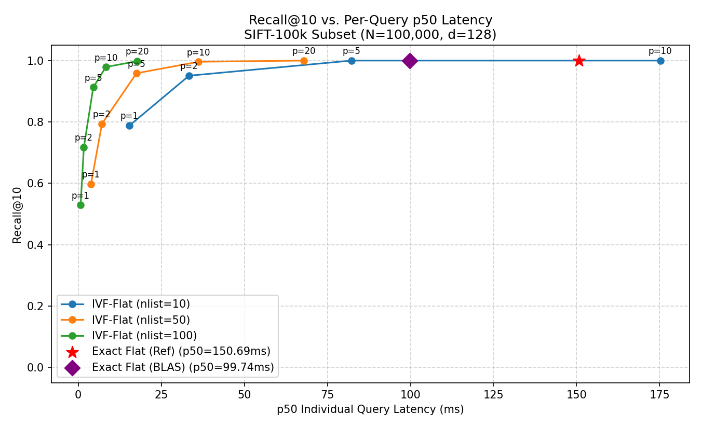
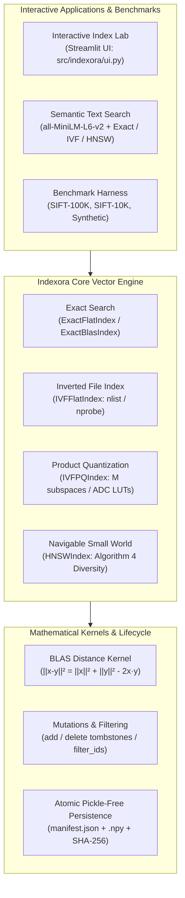

# Indexora

[](https://www.python.org/downloads/)
[]()
[](https://opensource.org/licenses/MIT)

**A learning-first vector search engine built from scratch in Python and NumPy.**

**[LIVE DEMO](https://indexora.onrender.com/)**

---

## Performance Overview & Benchmark Evidence

The tables below present verified, reproducible benchmark measurements across Indexora's core index implementations evaluated on the standard **Texmex SIFT** dataset ($d=128$, $k=10$, squared Euclidean distance).

### SIFT-100K Benchmark ($N=100,000$, $Q=1,000$, $d=128$)

| Architecture | Parameter Configuration | Recall@10 | Per-Query $p_{50}$ | Batch Throughput | Work per Query | Array Storage (MiB) | Memory Scaling Behavior |
| :--- | :---: | :---: | :---: | :---: | :---: | :---: | :--- |
| **Plain BLAS Scan** (Raw NumPy Reference) | Unconstrained GEMM | **1.0000** | ~2.10 ms | **474.8 QPS** | 100,000 ops | 48.83 MiB | Unbounded ($O(N \cdot Q)$ intermediate RAM) |
| **Exact (BLAS)** (Chunked Implementation) | `max_db_chunk=32768` | **1.0000** | 16.53 ms | **280.1 QPS** | 100,000 ops | 48.83 MiB | Bounded by database chunk ($O(\text{chunk} \cdot Q_{\text{chunk}})$) |
| **Exact (Reference)** (Oracle Loop) | Float64 coordinate loop | **1.0000** | 150.69 ms | 6.2 QPS | 100,000 ops | 48.83 MiB | Strict numerical reference oracle |
| **IVF-Flat** | $n_{\text{list}}=100, n_{\text{probe}}=1$ | 0.5287 | **0.72 ms** | **1,534.6 QPS** | 1,213 ops | 48.88 MiB | Fast candidate pruning |
| **IVF-Flat** | $n_{\text{list}}=100, n_{\text{probe}}=10$ | **0.9791** | 8.32 ms | 116.8 QPS | 10,928 ops | 48.88 MiB | High-recall operating point |
| **IVF-Flat** | $n_{\text{list}}=100, n_{\text{probe}}=20$ | **0.9980** | 17.75 ms | 55.9 QPS | 21,481 ops | 48.88 MiB | Near-lossless recovery |
| **IVF-PQ** (Residual Codes) | $n_{\text{list}}=100, M=16, n_{\text{probe}}=1$ | 0.4215 | 2.01 ms | **501.8 QPS** | 1,203 LUT | **2.46 MiB** | **$19.8\times$ Array Storage Reduction** |
| **IVF-PQ** (Residual Codes) | $n_{\text{list}}=100, M=16, n_{\text{probe}}=10$ | 0.6204 | 16.67 ms | 56.8 QPS | 10,723 LUT | **2.46 MiB** | **$19.8\times$ Array Storage Reduction** |
| **IVF-PQ** (Residual Codes) | $n_{\text{list}}=100, M=16, n_{\text{probe}}=20$ | **0.6236** | 33.39 ms | 35.5 QPS | 21,060 LUT | **2.46 MiB** | **$19.8\times$ Array Storage Reduction** |

### SIFT-10K Subset Benchmark ($N=10,000$, $Q=1,000$, $d=128$)
*Note: Evaluated on the first 10,000 base vectors with exact subset ground truth to respect pure-Python graph-traversal interpreter constraints. Not directly comparable in QPS to 100K runs due to dataset scale differences.*

| Architecture | Parameter Configuration | Recall@10 | Per-Query $p_{50}$ | Batch Throughput | Distance Ops / Query | Serialized Storage | Candidate Inspection |
| :--- | :---: | :---: | :---: | :---: | :---: | :---: | :--- |
| **HNSW** (Proximity Graph) | $M=16, ef_c=64, ef_s=16$ | **0.9423** | 2.29 ms | 396.8 QPS | **374** | 7.48 MiB (est.) | Inspects only 3.7% of database |
| **HNSW** (Proximity Graph) | $M=16, ef_c=64, ef_s=32$ | **0.9730** | 3.57 ms | 276.1 QPS | **545** | 7.48 MiB (est.) | Inspects only 5.4% of database |
| **HNSW** (Proximity Graph) | $M=16, ef_c=64, ef_s=64$ | **0.9881** | 5.68 ms | 176.6 QPS | **815** | 7.48 MiB (est.) | Inspects only 8.1% of database |
| **HNSW** (Proximity Graph) | $M=16, ef_c=64, ef_s=128$ | **0.9944** | 8.32 ms | 113.8 QPS | **1,215** | 7.48 MiB (est.) | Inspects only 12.1% of database |

<div align="center">
  
  <p><em>Figure 1: Verified SIFT-100k Recall@10 vs. Median Latency ($p_{50}$) tradeoff curve comparing Exact Reference, Exact BLAS, and IVF-Flat sweeps.</em></p>
</div>

### What These Measurements Mean

1. **Honest Baseline Comparison (Plain BLAS Scan vs. IVF-Flat):**
   - At $n_{\text{probe}}=1$, IVF-Flat achieves a **$3.2\times$ throughput speedup** over Plain BLAS matrix scan (1,534.6 vs. 474.8 QPS) at Recall@10 = 0.5287.
   - At $n_{\text{probe}}=10$, IVF-Flat achieves high recall (0.9791) and low single-query latency ($p_{50} = 8.32$ ms), but on full-batch queries it is **$4.1\times$ slower** than Plain BLAS (116.8 vs. 474.8 QPS). This is the honest reality of Python vector engines: Level-3 BLAS GEMM executes parallel SIMD hardware loops in optimized C/Fortran, while IVF-Flat candidate gathering must assemble NumPy slices through Python interpreter loops.
   - **Batch QPS vs. Per-Query $p_{50}$:** Batch QPS measures sustained query volume over full batches ($Q=1,000$), where Level-3 BLAS GEMM matrix parallelism dominates. Per-query $p_{50}$ measures response time for individual query invocations ($Q=1$), which run matrix-vector operations (GEMV).
   - **Chunked vs. Unconstrained Exact BLAS:** Plain BLAS computes an unconstrained $Q \times N$ matrix product allocating $400$ MB of intermediate RAM for $100$K vectors (and $>40$ GB for $10$M vectors). The chunked implementation (`ExactBlasIndex`, `max_db_chunk=32768, max_query_chunk=1024`) trades peak throughput to bound intermediate memory to $O(\text{chunk} \cdot Q_{\text{chunk}})$ ($\approx 134.2$ MB intermediate array), delivering **280.1 QPS** while guaranteeing bounded database-chunk memory.
2. **IVF-PQ Memory Accounting & Accuracy Boundaries:**
   - **Persistent Array Storage:** 2.46 MiB ($2,582,272$ bytes) covers coarse centroids ($0.05$ MiB), codebooks ($0.13$ MiB), residual quantization codes ($1.53$ MiB), and external IDs ($0.76$ MiB).
   - **Container Overhead:** Additional persistent Python dataclass and list container overhead is approximately $0.03$ MiB ($31$ KB), bringing total persistent index structures to $\approx 2.49$ MiB.
   - **Compression Ratios:** Against raw float32 vectors alone ($48.83$ MiB / $51.2$ MB), array storage achieves a **$19.8\times$ reduction** ($19.6\times$ including Python container overhead). Against raw vectors plus stored int64 IDs ($49.59$ MiB), array storage achieves a **$20.1\times$ reduction** ($19.9\times$ total).
   - **Build & Training Memory:** Temporary residual vectors during $K$-means training require $48.83$ MiB; peak process RSS during the full build reached $143.6$ MiB.
   - **Accuracy Boundary:** Maximum tested recall on SIFT-100K is **0.6236 at $n_{\text{probe}}=20$** (moderate recall bounded by 8-bit residual quantization distortion).
3. **HNSW Proximity Graph Scaling & Memory Qualification:**
   - Evaluated on the 10,000-vector SIFT subset, HNSW achieves **94.2% to 99.4% recall** while computing only **374 to 1,215 vector distances per query** (inspecting just 3.7% to 12.1% of the database).
   - **Memory Qualification:** The reported 7.48 MiB is a **logical serialized-storage estimate** based on contiguous arrays ($4.88$ MiB vectors + $0.08$ MiB IDs + $2.52$ MiB 64-bit CSR graph edges). In-memory Python heap overhead (nested `list[list[int]]` pointer structures and Python integer objects) adds runtime overhead that cannot be isolated from total process RSS ($150.4$ MiB); therefore, 7.48 MiB is strictly documented as a serialized storage estimate. Query latency ($2.3$ to $8.3$ ms) is governed by Python bytecode dispatch overhead during graph traversal.

---

## Core Algorithms Implemented

Indexora implements foundational vector search data structures and algorithms from scratch without black-box C++ libraries:

1. **Exact Exhaustive Search (`ExactFlatIndex`, `ExactBlasIndex`):**
   - Coordinate-difference numerical oracle with 64-bit float accumulation.
   - Level-3 BLAS norm expansion ($\|q - x\|^2 = \|q\|^2 + \|x\|^2 - 2(q \cdot x)$) with deterministic lexicographical tie-breaking (`np.lexsort`).
   - Bounded block-chunked batched GEMM to guarantee bounded memory footprints on arbitrarily large vector collections.
2. **Inverted File Flat (`IVFFlatIndex`):**
   - Vectorized $K$-means++ centroid initialization with Lloyd iteration.
   - Dynamic multi-probe candidate gathering across $n_{\text{probe}}$ Voronoi cells.
   - Exact in-path distance accounting and bit-for-bit equivalence with exact scan when $n_{\text{probe}} = n_{\text{list}}$.
3. **Product Quantization & IVF-PQ (`ProductQuantizer`, `IVFPQIndex`):**
   - Subspace decomposition ($d = M \times d_{\text{sub}}$) with 8-bit codebooks (`uint8`).
   - Coarse-centroid residual quantization and Asymmetric Distance Computation (ADC) lookup table (LUT) scoring.
   - Delivers up to $20.8\times$ persistent memory compression.
4. **Hierarchical Navigable Small World (`HNSWIndex`):**
   - Multi-layer proximity graph with exponential level sampling ($m_L = 1 / \ln(M)$).
   - Best-first greedy routing on upper layers, beam search on layer 0.
   - Malkov & Yashunin's Algorithm 4 heuristic diversity pruning to enforce spatial coverage.
5. **Full Vector Lifecycle & Persistence:**
   - Incremental ingestion (`add`) and tombstone deletion (`delete`) preserving graph reachability.
   - Single-stage candidate filtering (`filter_ids`).
   - Pickle-free atomic disk persistence (`save_index`, `load_index`) with `.npy` arrays and streaming SHA-256 manifests.

---

## System Architecture



---

## How to Run Locally

### 1. Prerequisites & Virtual Environment

Requires **Python 3.10+**:

```bash
# Clone the repository
git clone https://github.com/ShivanshDubeyONG/Indexora.git
cd Indexora

# Create virtual environment
python -m venv venv

# Activate (Windows)
.\venv\Scripts\activate

# Activate (Linux / macOS)
source venv/bin/activate

# Install core and UI dependencies
pip install -e ".[dev,benchmark,ui]"
```

### 2. Verify the Test Suite (Offline)

```bash
pytest -q
```
Runs **377 passing tests** verifying kernels, clustering, IVF, PQ, HNSW, persistence, and semantic APIs in $<100$ seconds.

### 3. Run the Smoke Benchmark

```bash
python -m indexora.benchmark --smoke --no-plot
```
Executes an offline synthetic benchmark verifying exact scan baselines, multi-probe IVF recall, and distance accounting in $<2$ seconds.

### 4. Launch the Interactive Index Lab

```bash
streamlit run src/indexora/ui.py
```
Launches the interactive dashboard at `http://localhost:8501`.

---

## 10-Second Code Example

```python
import numpy as np
from indexora import HNSWIndex, normalize_l2

# 1. Prepare unit-normalized vectors (d=128)
vectors = normalize_l2(np.random.randn(1000, 128).astype(np.float32))
ids = np.arange(1000, dtype=np.int64)

# 2. Build an HNSW proximity graph
index = HNSWIndex(database=vectors, ids=ids, M=8, ef_construction=32, ef_search=16)

# 3. Query nearest neighbors with cosine ranking
query = normalize_l2(np.random.randn(128).astype(np.float32))
result = index.search(query, k=5)

# 4. Results contain IDs, squared L2 distances, and valid match mask
print("Retrieved IDs:", result.ids)
print("Squared L2 Distances:", result.distances)
print("Cosine Similarities:", 1.0 - 0.5 * result.distances)
```

---

## Benchmark Methodology & Limitations

1. **Hardware & Environment:**
   - Single-process execution on AMD Ryzen / Intel x86_64 CPU workstation with OpenBLAS / MKL backends.
   - Raw dataset: Texmex SIFT-1M (`sift_base.fvecs`, `sift_query.fvecs`).
2. **Metrics Tracked:**
   - **Recall@k:** Fraction of ground-truth top-$k$ nearest neighbors retrieved.
   - **Per-Query $p_{50}$:** Median execution latency sampled across individual single-query invocations.
   - **Batch Throughput (QPS):** Total queries divided by total wall-clock time over repeated batched evaluation.
   - **Distance Computations / LUT Lookups:** Exact counter of vector distance operations or ADC table lookups in the inner retrieval loop.
3. **Engineering Limitations:**
   - **Python Overhead:** Python's bytecode interpreter imposes loop overhead during graph traversal and posting list assembly. C++ engines like FAISS or hnswlib will achieve significantly higher absolute QPS on identical hardware.
   - **Quantization Noise:** Product quantization is inherently lossy; for applications requiring $>95\%$ recall with compact storage, exact reranking or larger codebooks are necessary.
   - **HNSW Deletions:** Deletions are implemented via logical tombstones to protect graph connectivity without triggering expensive graph re-indexing.

---

## Essential Documentation

- **[`docs/decisions.md`](docs/decisions.md):** Architecture Decision Records (ADRs 0001 through 0010) documenting design choices and security boundaries.
- **[`docs/BENCHMARK_METHODOLOGY.md`](docs/BENCHMARK_METHODOLOGY.md):** Detailed benchmarking protocol, hardware specs, and cryptographic dataset checksums.
- **[`docs/RELEASE_HISTORY.md`](docs/RELEASE_HISTORY.md):** Consolidated changelog across releases (`v0.1`, `v1.0`, `v1.0.1`).
- **[`docs/interview_practice.md`](docs/interview_practice.md):** First-principles vector search practice guide covering mathematical derivations, complexity, edge cases, and whiteboard implementations from memory.
- **[`docs/architecture.md`](docs/architecture.md):** Technical design reference and internal data structures.
- **[`docs/DEMO_WALKTHROUGH.md`](docs/DEMO_WALKTHROUGH.md):** Step-by-step 2–3 minute technical interview walkthrough script.

---

## License

Indexora is released under the [MIT License](LICENSE).
Copyright (c) 2026 Shivansh Dubey and Indexora Contributors.
