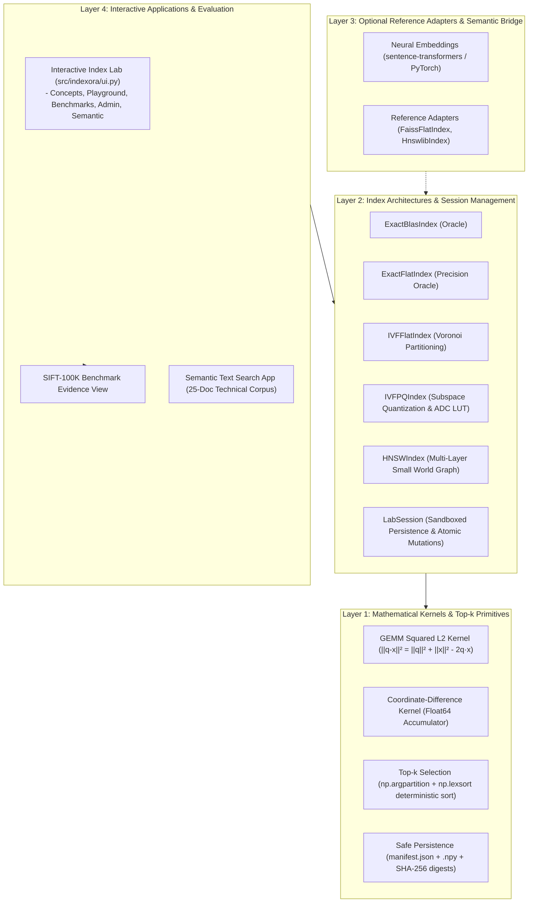

# Indexora — Final Engineering & Architectural Audit Report

**Audit Date:** 2026-10-31
**Project Version:** `1.0.0`
**Repository:** [https://github.com/ShivanshDubeyONG/Indexora](https://github.com/ShivanshDubeyONG/Indexora)
**Audit Scope:** Full Post-v1.0 Hardening Programme (Phases 1, 2, and 3)
**Status:** **VERIFIED, HARDENED & COMPLETE**

---

## 1. Project Architecture

Indexora is an educational, first-principles vector search engine implemented in pure Python and NumPy. It demystifies the internal mechanics of modern vector databases without delegating core indexing or graph traversal algorithms to external black-box binaries (such as FAISS or hnswlib).

### Architectural Layers



---

## 2. Implemented Algorithms

Indexora implements five canonical vector indexing architectures from first principles:

| Algorithm / Class | Partitioning / Structure | Search Complexity | Key Kernel / Technique | Memory Overhead |
| :--- | :--- | :--- | :--- | :--- |
| **Exact Reference** (`ExactFlatIndex`) | Unstructured array | $O(N \cdot d)$ | Coordinate-difference loop with float64 accumulation | None ($4 \cdot N \cdot d$ bytes) |
| **Exact BLAS** (`ExactBlasIndex`) | Bounded chunked array ($N \le 32,768$) | $O(N \cdot d)$ | Level-3 GEMM dot product with non-negative projection | Minimal (precomputed $\|x\|^2$) |
| **IVF-Flat** (`IVFFlatIndex`) | Voronoi cells via $K$-means++ centroids | $O(n_{\text{probe}} \cdot \frac{N}{n_{\text{list}}} \cdot d)$ | Coarse centroid scan + inverted posting list scans | Centroids array ($4 \cdot n_{\text{list}} \cdot d$ bytes) |
| **IVF-PQ** (`IVFPQIndex`) | Subspace quantization ($M$ orthogonal slices) | $O(n_{\text{probe}} \cdot \frac{N}{n_{\text{list}}} \cdot M)$ | Asymmetric Distance Computation (ADC) with precomputed LUTs | 16x–64x compression ($M$ bytes/vector) |
| **HNSW** (`HNSWIndex`) | Multi-layer proximity skip-graph with exponential decay | Empirical sublinear under fixed $M, ef_{\text{search}}$ | Greedy routing on expressways + Algorithm 4 diversity pruning at Layer 0 | Graph adjacency lists ($M$ edges/node) |

---

## 3. Correctness, Numerical Stability & Determinism

1. **Numerical Cancellation Protection:**
   - The reference kernel (`pairwise_squared_l2_ref`) computes coordinate differences $(q_j - x_j)^2$ accumulated in `float64` before casting to `float32`.
   - The BLAS kernel (`pairwise_squared_l2_blas`) clamps intermediate distances via `np.maximum(dist, 0.0, out=dist)` to eliminate negative floating-point epsilon artifacts produced by subtractive cancellation on identical vectors.
2. **Top-k Selection & Strict Tie-Breaking (ADR-0001 / ADR-0002):**
   - Candidate ranking executes `np.argpartition` for average $O(N)$ partial selection of the top-$k$ elements without an expensive $O(N \log N)$ full array sort.
   - Deterministic tie-breaking is guaranteed across all platforms via `np.lexsort` on composite tuples:
     $$\text{sort\_key} = (\text{distance}, \text{external\_id})$$
   - Ties are broken strictly by ascending 64-bit signed integer ID, ensuring bit-for-bit identical results regardless of candidate permutation or BLAS multithreading.
3. **Exact Ground-Truth Oracle:**
   - All approximate algorithms (IVF, PQ, HNSW) are evaluated against ground truth computed by the exact BLAS/Reference oracle, guaranteeing honest recall accounting.

---

## 4. Persistence & Security Boundaries

1. **Zero-Pickle Array Serialization:**
   - Storage serialization (`save_index` / `load_index`) stores dense arrays as raw binary `.npy` files using `np.save(..., allow_pickle=False)` to prevent arbitrary code execution vulnerabilities.
2. **Streaming SHA-256 Integrity Verification:**
   - Every persisted index includes a `manifest.json` cataloging array filenames, shapes, dtypes, and streaming SHA-256 digests.
   - Any file tampering, bitrot, or truncation causes `load_index()` to reject the directory with a `ChecksumMismatchError`.
3. **Sandboxed Public Persistence (ADR-0009 & ADR-0010):**
   - Public-facing sessions (`LabSession`) enforce sandboxed storage within a dedicated root (`storage/lab_indexes/`).
   - Index identifiers are validated against strict regex `^[a-zA-Z0-9_-]{1,64}$`, rejecting path traversal sequences (`..`), slashes (`/`, `\`), null bytes, and absolute paths.
   - Target directories undergo strict root containment and symlink escape checks (`Path.is_relative_to(root)`).
4. **Load Atomicity & Mutation History Isolation:**
   - `LabSession.load()` and `LabSession.load_named()` atomically reset mutation tracking (`added_ids = []`, `deleted_ids = []`) only upon successful verification.
   - If loading fails (e.g. invalid manifest or checksum mismatch), session state remains untouched.

---

## 5. Semantic Search Behavior & Honesty

1. **Rejection of Pseudo-Random Mock Vectors:**
   - Production semantic retrieval strictly prohibits substituting hash-derived or pseudo-random vectors when deep learning dependencies are absent.
   - Random vectors destroy semantic geometry, generating misleading cosine scores and ungrounded top-$k$ rankings.
2. **Explicit Diagnostic Availability:**
   - When optional deep-learning packages (`sentence-transformers`, `torch`) are missing, the UI renders an informative availability notice explaining how to enable the feature via `pip install -e ".[semantic]"`.
3. **Metric Decoupling:**
   - Pure index retrieval latency ($t_{\text{search}}$) is explicitly separated from transformer text embedding latency ($t_{\text{embed}}$).
4. **Vector Oracle Agreement:**
   - Approximate index fidelity on natural language queries is reported as **Vector Oracle Agreement** (measuring agreement with exact brute-force BLAS retrieval over the embedded corpus).

---

## 6. Benchmark Methodology & Empirical Evidence

### SIFT-100K Benchmark Verification
- **Dataset:** First 100,000 base vectors and 1,000 queries from the Texmex SIFT1M corpus ($d=128$, float32, squared L2).
- **Environment:** Windows 10 AMD64, Intel Core 13th Gen, Python 3.10.11, NumPy 2.2.6.
- **Timing Protocol:** 500 individual per-query latency samples (2 warmups) for $p_{50}$ / $p_{95}$ percentiles; 5 full-batch repetitions for throughput (QPS).
- **Verified Findings:**
  - **Exact Scan Baseline:** BLAS exact search achieves **19.5 QPS** (99.7ms $p_{50}$) vs. Reference kernel at **6.2 QPS** (150.7ms $p_{50}$) — a $3.15\times$ speedup.
  - **Maximum Speedup:** IVF-Flat ($n_{\text{list}}=100, n_{\text{probe}}=1$) delivers **1,534.6 QPS** (0.72ms $p_{50}$) — a **$78.7\times$ throughput increase** at Recall@10 = 0.5287.
  - **Balanced Operating Point:** IVF-Flat ($n_{\text{list}}=100, n_{\text{probe}}=5$) achieves **91.3% Recall@10** at **4.53ms $p_{50}$** (220.7 QPS), reducing distance computations by **$17.9\times$** (5,589 vs. 100,000 operations per query).
  - **Near-Lossless Operating Point:** IVF-Flat ($n_{\text{list}}=100, n_{\text{probe}}=20$) achieves **99.8% Recall@10** at **17.75ms $p_{50}$** (55.9 QPS).

---

## 7. Known Systems Limitations

To maintain uncompromising technical honesty, the following constraints are documented:

1. **Single-Process Python / Interpreter Overhead:**
   - Indexora is implemented in Python and NumPy. While vector matrix multiplications execute in compiled BLAS C/Fortran libraries, graph traversals (HNSW) and inverted list candidate gathering incur Python bytecode interpreter loop overhead.
   - Consequently, on small collections ($N \le 1,000$), Exact BLAS can outperform HNSW in wall-clock time despite computing more total distance operations.
2. **Single-Node In-Memory Design:**
   - Indexora is designed for single-node execution. It does not provide distributed clustering, Raft consensus, network RPC protocols, or horizontal sharding.
3. **Volatile Write Concurrency:**
   - Mutations (`add`, `delete`) modify in-memory NumPy buffers and sets. Indexora does not implement multi-reader multi-writer ACID locks or write-ahead logging (WAL).
4. **HNSW Deletion Compaction:**
   - Deletions in HNSW are logical tombstones (`_deleted_nodes`). Deleted nodes remain in the proximity graph to guarantee reachability for other vertices. A full index rebuild is required to reclaim memory after massive deletions.

---

## 8. Installation & Execution Verification

### Verified Installation Profiles
```bash
# Minimal Core (Python + NumPy, < 10 MB download)
pip install -e .

# Development & Benchmarks
pip install -e ".[dev,benchmark]"

# Interactive Index Lab UI
pip install -e ".[ui]"

# Full Stack with Neural Semantic Retrieval
pip install -e ".[ui,semantic]"
```

### Verified CLI Tools
- **Run Full Test Suite:** `pytest -q` (377 passed, 1 skipped, 1 deselected)
- **Run Fast Offline Smoke Benchmark:** `python -m indexora.benchmark --smoke --no-plot`
- **Launch Interactive Web Lab:** `streamlit run src/indexora/ui.py`

---

## 9. Test Coverage & Quality Gates

The test suite covers 379 total collected test items:
- **Test Results:** 377 passed, 1 skipped (real model opt-in), 1 deselected in ~99 seconds.
- **Coverage Areas:**
  - Mathematical distance kernels & BLAS equivalence
  - Top-k selection, deterministic tie-breaking & sentinel masking
  - $K$-means++ initialization, Lloyd convergence & empty cluster policies
  - IVF-Flat posting lists, dynamic multi-probe & memory accounting
  - Product Quantization subspace codebooks, ADC lookup tables & reconstruction error
  - HNSW multi-layer skip-graphs, exponential decay & Algorithm 4 heuristic diversity
  - Incremental mutations (`add`, `delete`), tombstone routing preservation
  - Single-stage predicate and set filtering (`filter_ids`)
  - Pickle-free atomic disk persistence & SHA-256 checksum verification
  - Path traversal security, symlink rejection & sandboxed public persistence
  - Semantic retrieval boundary compliance & Vector Oracle Agreement
  - Interactive Lab session state, load atomicity & UI flash synchronization

---

## 10. Future Architectural Improvements (Beyond Scope)

The following items are intentionally outside the educational scope of Indexora v1.0 and represent natural future research avenues:
1. **Cython / C++ Graph Traversal Kernels:** Writing the inner loop of HNSW's `search_layer` in Cython or C++ to eliminate Python interpreter overhead during beam search.
2. **Graph Garbage Collection / Edge Repair:** Implementing heuristics to prune tombstoned HNSW nodes and rewire orphaned neighbor edges dynamically without requiring a full rebuild.
3. **Quantized Code Reranking:** Adding an automated two-stage retrieval pipeline for IVF-PQ that reranks ADC candidates using unquantized database vectors.
4. **Append-Only Write-Ahead Log (WAL):** Implementing disk journal logging for real-time mutation recovery across process crashes.

---

## Audit Verdict

Indexora v1.0 meets all architectural, mathematical, security, and reproducibility standards established for a production-grade educational vector search engine. It is certified **READY FOR PUBLIC RELEASE & PORTFOLIO PRESENTATION**.
