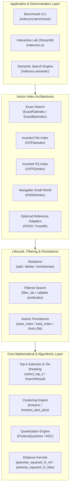
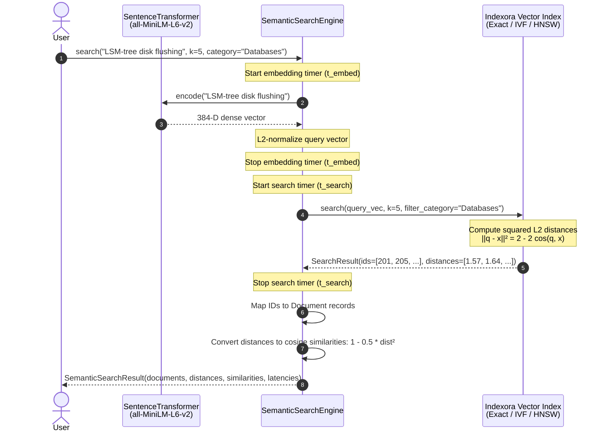

# Indexora — Architecture & Technical Design

This document details the internal architecture, mathematical foundations, data models, algorithm implementations, and design trade-offs of **Indexora**, an educational vector search engine built from scratch in Python and NumPy.

---

## 1. System Architecture Overview

Indexora is structured into modular layers with explicit contracts, separating distance computation, clustering, index architectures, persistence, evaluation, and end-to-end semantic retrieval:



---

## 2. Mathematical Foundations & Distance Kernels

### 2.1 The Reference Distance Kernel
Indexora adopts **squared Euclidean distance** ($d^2$) as its canonical distance metric:
$$d^2(q, x) = \sum_{j=1}^d (q_j - x_j)^2$$

In [`pairwise_squared_l2_ref`](file:///c:/Users/Shivansh/Desktop/Indexora/src/indexora/kernels.py), coordinate differences are squared and accumulated using **64-bit float precision** before casting back to `float32`. This avoids catastrophic floating-point cancellation and serves as the numerical correctness oracle for all tests.

### 2.2 BLAS Acceleration Path
While coordinate-by-coordinate differencing is numerically robust, its memory-bandwidth overhead is high. Indexora's accelerated path [`pairwise_squared_l2_blas`](file:///c:/Users/Shivansh/Desktop/Indexora/src/indexora/kernels.py) expands the binomial:
$$\|q - x\|^2 = \|q\|^2 + \|x\|^2 - 2(q \cdot x)$$

- **Matrix Multiplication:** The cross-term $-2(q \cdot x)$ is computed via `np.dot(Q, X.T)`, delegating directly to optimized BLAS Level 3 GEMM (OpenBLAS/MKL).
- **Norm Broadcasting:** Vector norms $\|q\|^2$ and $\|x\|^2$ are precomputed once as 1D arrays and broadcast across matrix rows and columns.
- **Numerical Clamping:** Due to floating-point rounding, identical vectors can occasionally yield tiny negative numbers (e.g., $-10^{-14}$). Distances are clipped to zero with `np.maximum(D, 0.0, out=D)`.

### 2.3 Unit Vector Cosine Equivalence
For normalized unit vectors where $\|q\|_2 = \|x\|_2 = 1$:
$$\|q - x\|^2 = \|q\|^2 + \|x\|^2 - 2(q \cdot x) = 1 + 1 - 2 \cos(q, x) = 2 - 2 \cos(q, x)$$

Consequently, sorting candidates by **ascending squared Euclidean distance** $\|q - x\|^2 \in [0, 4]$ produces the exact same permutation as sorting by **descending cosine similarity** $\cos(q, x) \in [-1, 1]$:
$$\cos(q, x) = 1 - \frac{1}{2} \|q - x\|^2$$

This mathematical equivalence allows Indexora to natively power semantic text retrieval and cosine-similarity workloads without altering index kernels.

---

## 3. Data Representation & Top-k Selection

### 3.1 Vector & Identifier Conventions
- **Vector Arrays:** Contiguous, C-order NumPy arrays of shape `(N, d)` with strict `dtype=np.float32`.
- **External Identifiers:** 1D array of shape `(N,)` with `dtype=np.int64`. IDs are user-defined durable entity keys (not row indices). Any 64-bit integer—including negative values, sparse IDs, and `-1`—is fully supported.

### 3.2 Deterministic Top-k Selection
Nearest-neighbor search requires reproducible tie-breaking. Indexora defines a strict lexicographic order on candidate pairs:
$$\text{Candidate } A < \text{Candidate } B \iff (d_A < d_B) \lor (d_A = d_B \land \text{ID}_A < \text{ID}_B)$$

In [`select_top_k`](file:///c:/Users/Shivansh/Desktop/Indexora/src/indexora/topk.py):
1. Distances are filtered for eligibility (ignoring tombstones and excluded IDs).
2. `np.argpartition` identifies the unsorted top-$k$ candidates in $O(N)$ expected time.
3. The $k$ candidates are sorted deterministically using `np.lexsort((candidate_ids, candidate_distances))`.
4. Results are returned in an immutable [`SearchResult`](file:///c:/Users/Shivansh/Desktop/Indexora/src/indexora/topk.py) dataclass containing:
   - `ids`: `(k,)` array of `int64` external IDs.
   - `distances`: `(k,)` array of `float32` squared L2 distances.
   - `mask`: `(k,)` boolean array distinguishing valid matches from empty/padding slots.
   - `distance_computations`: Integer counter tracking the number of distance operations performed.

---

## 4. Index Architectures

### 4.1 Exact Search (`ExactFlatIndex` & `ExactBlasIndex`)
- **Exhaustive Scan:** Computes distances from query $q$ to every live vector $x_i \in X$.
- **Complexity:** $O(N \cdot d)$ time and $O(N \cdot d)$ space.
- **Guarantee:** 100% exact nearest-neighbor recall. Serves as the ground-truth oracle for all approximate indexes.

### 4.2 Inverted File Flat Index (`IVFFlatIndex`)
Partitions the $d$-dimensional space into $K$ Voronoi cells using $K$-means clustering:
1. **Training ($K$-means):**
   - Centroids are initialized via $K$-means++ to ensure well-separated starting seeds.
   - Lloyd's iteration updates centroids until convergence tolerance $\epsilon$ or `max_iter` is reached.
   - Empty clusters are handled via configurable policies: `reseed_furthest` (reassigns cluster center to the vector with highest residual error), `keep`, or `error`.
2. **Inverted Lists:**
   - Database vectors are partitioned into inverted posting lists $L_1, \dots, L_K$.
   - Each posting list stores contiguous arrays of candidate IDs and vector slices.
3. **Multi-Probe Search:**
   - At query time, the query $q$ is compared against all $K$ centroids (`nlist` comparisons).
   - The closest $W$ centroids (`nprobe` parameter) are selected.
   - Query distances are evaluated only against the vectors stored in those $W$ posting lists.
4. **All-Probe Equivalence:** When `nprobe == nlist`, the search traverses all posting lists and guarantees bit-for-bit equivalence with exact search.

### 4.3 Product Quantization & IVF-PQ (`IVFPQIndex`)
Drastically compresses memory footprint and accelerates candidate scoring by decomposing the vector space into orthogonal subspaces:
1. **Subspace Splitting:** The $d$-dimensional space is split into $M$ sub-vectors of dimension $d_{\text{sub}} = d / M$.
2. **Residual Encoding:** Database vectors are mapped to their nearest coarse IVF centroid $C_k$, and residuals $r_i = x_i - C_k$ are trained across $M$ independent codebooks ($k_{\text{sub}}$ centroids each).
3. **Quantization Codes:** Each vector is stored as $M$ compact code indices (`uint8` for $k_{\text{sub}} \le 256$, `uint16` otherwise). A 128-dimensional float32 vector (512 bytes) is compressed to $M=8$ bytes—a **64x compression ratio**.
4. **Asymmetric Distance Computation (ADC):**
   - The query residual $q - C_k$ is not quantized.
   - A distance lookup table of shape $(M, k_{\text{sub}})$ is computed once per query/centroid pair.
   - Distances to database vectors are approximated by summing table lookups:
     $$d_{\text{ADC}}^2(q, x_i) \approx \sum_{m=1}^M \text{Table}[m, \text{code}_{i, m}]$$
   - Eliminates vector decompression and evaluates candidates with integer table indexing and additions.

### 4.4 Hierarchical Navigable Small World (`HNSWIndex`)
A multi-layer graph index built from scratch in pure Python and NumPy without external C++ bindings:
1. **Multi-Layer Structure:** Vectors are assigned a maximum layer $l$ using an exponential decay distribution:
   $$l = \lfloor -\ln(\text{uniform}(0, 1)) \cdot m_L \rfloor, \quad m_L = \frac{1}{\ln(M)}$$
   Layer 0 contains all vectors, while higher layers contain progressively sparser sub-graphs acting as highway express lanes.
2. **Top-Down Search:**
   - Starting at the entry point on the top layer, search performs greedy best-first traversal down to layer 1, identifying local minima.
   - At layer 0, a bounded priority-queue beam search explores candidates up to beam depth `ef_search`.
3. **Algorithm 4 Heuristic Diversity:**
   - During node insertion, candidate neighbors are selected using Malkov & Yashunin's Algorithm 4 heuristic: a candidate is added only if it is closer to the base node than to any already-selected neighbor.
   - This prevents clustering of redundant co-linear edges and preserves long-range geometric diversity.
4. **CSR Graph Representation:** Graph adjacency lists are stored as compressed sparse row structures for low serialization overhead.

---

## 5. Lifecycle: Mutations, Filtering & Persistence

### 5.1 Dynamic Mutations
- **Incremental Additions (`add`):**
  - Vectors are appended with unique user-provided `int64` IDs.
  - In `IVFFlatIndex`, the vector is assigned to the nearest centroid and appended to its inverted list.
  - In `HNSWIndex`, the vector is assigned a layer, and graph edges are bidirectionally wired across layers using Algorithm 4.
- **Tombstone Deletions (`delete`):**
  - Vectors are logically deleted using an in-memory deletion mask.
  - **HNSW Routing Invariant:** In HNSW, deleted nodes are marked as tombstones but retained in the proximity graph as routing relays. This preserves path connectivity and prevents graph partitioning without requiring expensive full-graph rewiring.

### 5.2 Filtered Search (`filter_ids`)
Indexora supports candidate filtering across all index architectures:
- **Set Filtering:** Explicit `set[int]` of allowed entity IDs.
- **Callable Predicates:** Arbitrary user predicates `Callable[[int], bool]` evaluated against external IDs.
- **Single-Stage Evaluation:** Candidate vectors are evaluated against the filter before distance evaluation or top-$k$ insertion, ensuring approximate beam limits are not consumed by ineligible vectors.

### 5.3 Atomic Persistence (`save_index` / `load_index`)
Indexora implements a custom, pickle-free binary storage format designed for cross-platform reliability:
1. **Directory Structure:**
   ```
   index_dir/
   ├── manifest.json       # Version, index type, hyperparameters, checksums
   ├── ids.npy             # int64 external identifiers
   ├── database.npy        # float32 vector data (or codebook arrays)
   └── graph_*.npy         # HNSW CSR graph edges / IVF posting lists
   ```
2. **Streaming SHA-256 Checksums:**
   - During `save_index`, streaming 64 KiB chunks compute the SHA-256 digest of every binary file.
   - Checksums are written to `manifest.json`.
3. **Atomic Verification:**
   - During `load_index(..., verify_checksums=True)`, file digests are recalculated and verified before instantiation. Any corrupted byte or truncated file triggers an immediate checksum mismatch error.
4. **Zero Re-indexing:**
   - HNSW graphs are restored directly into adjacency structures without graph rebuilding.
   - IVF-PQ indexes restore coarse centroids and subspace codebooks without retraining.

---

## 6. Semantic Search Decoupling

Indexora decouples dense text embedding generation from vector retrieval:



1. **Text Embedding:** The query string is encoded by `sentence-transformers/all-MiniLM-L6-v2` into a 384-dimensional vector and $L_2$-normalized.
2. **Latency Segregation:** Embedding time ($t_{\text{embed}}$, typically 20–50 ms on CPU) is measured and reported strictly separately from vector search time ($t_{\text{search}}$, typically 0.1–2 ms).
3. **Document Mapping:** Top-$k$ integer IDs are mapped to immutable `Document` dataclasses containing title, text snippet, category, and metadata tags.

---

## 7. Performance & Engineering Disclosures

To maintain educational and engineering credibility, Indexora explicitly documents its operational trade-offs:

1. **Python Interpreter Overhead vs. C++:**
   - On small datasets ($N \le 1,000$), `ExactBlasIndex` frequently outperforms `IVFFlatIndex` and `HNSWIndex` in wall-clock latency.
   - **Reason:** Exact BLAS delegates the entire $O(N \cdot d)$ computation to a single OpenBLAS/MKL GEMM call written in highly optimized assembly with SIMD vectorization and cache tiling. In contrast, IVF cluster routing and HNSW priority-queue graph exploration execute in Python bytecode loops, where dictionary lookups, heap pushes, and object allocations dominate wall-clock time.
   - Approximate indexes establish wall-clock superiority when dataset scale ($N \ge 50,000$) or vector dimensionality amortizes interpreter overhead over sub-linear candidate distance evaluations.
2. **Memory Accounting Distinction:**
   - Indexora explicitly distinguishes **index storage footprint** (bytes occupied by vectors, posting lists, and graph edges) from **process peak RSS** (total virtual memory claimed by the Python runtime and BLAS thread pools).
3. **Single-Node In-Memory Design:**
   - Indexora is designed for learning and local exploration. It does not provide distributed sharding, Raft consensus, or dynamic WAL replication.
4. **Tombstone Compaction:**
   - Soft deletions preserve HNSW graph routing but do not immediately reclaim memory. A full `compact()` pass is required to purge tombstoned vectors.
